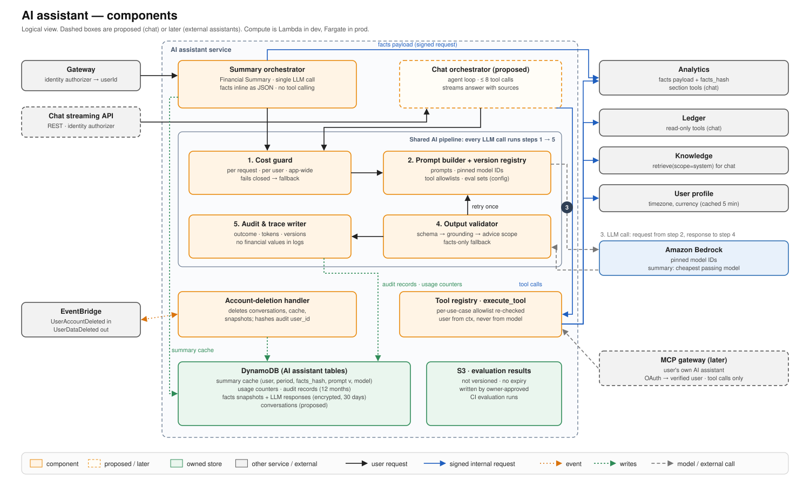
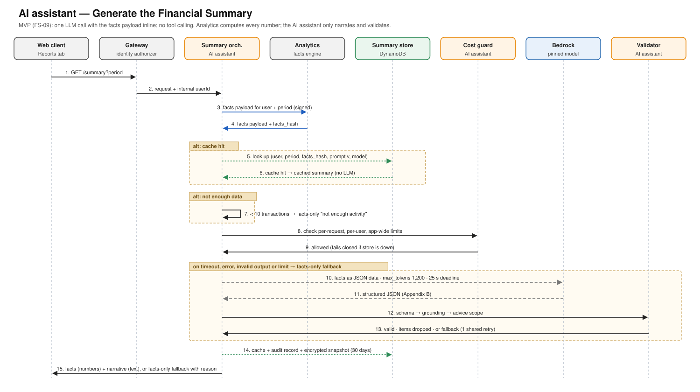
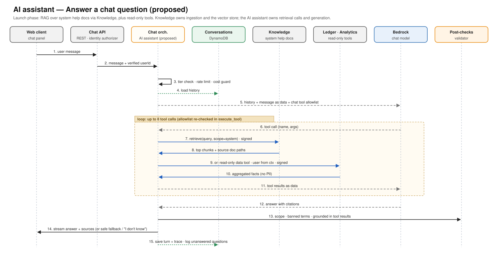
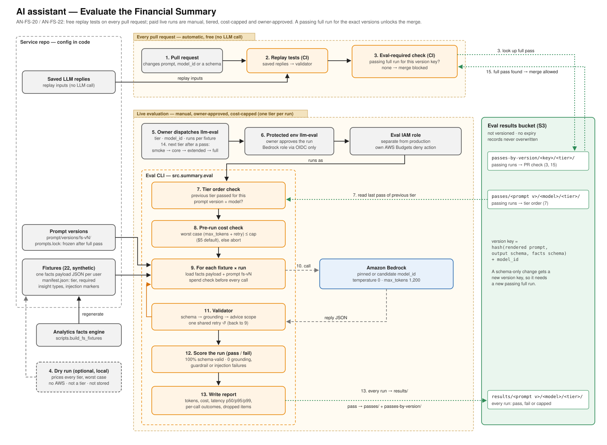

# AI Assistant Architecture

| Status | Owner | Last reviewed | Applies to | App architecture |
|---|---|---|---|---|
| Proposed (Refactor phase: moving out of Analytics) | Van Vo | 2026-10-28 | main | [FinTracker architecture](../../fintracker-architecture/fintracker-architectural-doc.md) |

This document describes how the AI assistant works: its components and the workflows it owns. Rules that apply to every service are in the app architecture doc and are not repeated here. These include identity, events and invariants. Field-level schemas, prompts, thresholds and acceptance criteria live in the specs, such as [AN-FS: Financial Summary](../../fintracker-analytics/specs/AN-FS-financial-summary-spec.md).

---

## 1. Overview

**Purpose:** the AI assistant is the only FinTracker service that calls an LLM. It turns facts computed by other services into explanations and answers, and keeps all AI risk in one place: prompts, model choice, guardrails, evaluation and LLM cost.

**Responsibilities**
- **Financial Summary (MVP):** generates, validates, caches and audits the AI narrative on the Reports tab, using the facts payload from Analytics.
- **Chat** *(proposed, Launch phase)*: answers user questions with read-only tools and retrieval over system help docs.
- **Tool registry:** the tool definitions the model can see, a per-use-case allowlist, and `execute_tool` as the single place every tool call passes through.
- **Shared AI pipeline:** prompt and model versions, cost guard, output validation, audit and traces.
- **Evaluation:** offline evaluation sets and owner-approved live runs before any prompt, model or schema change ships.
- **External assistants** *(later)*: exposes the same tools to a user's own AI assistant through an MCP gateway.

**Does not do**
- Compute any financial figure. Analytics computes metrics and detectors.
- Read any database. It calls other services' APIs as tools.
- Ingest documents or own the vector store. Knowledge does both; the AI assistant only calls `retrieve`.
- Write financial data. All tools are read-only by default.

**Owns**
- Summary cache, usage counters, audit records, facts snapshots and LLM responses.
- Conversations *(proposed)*.
- The tool catalog, prompts and model configuration (as config in code).
- Evaluation results.

---

## 2. Architecture and workflows

**How to read the diagram**
- The two **orchestrators** are the only entry points, one per use case. Both run every LLM call through the same **shared AI pipeline**, in order: cost guard → prompt builder → model call → output validator (one retry back to the prompt builder) → audit writer.
- The **Financial Summary** gets its facts from Analytics in one signed request and makes one LLM call. Only **chat** uses the tool registry.
- Every tool call goes through `execute_tool`. It re-checks the use case's allowlist, because the model's tool name is untrusted input, and takes the user from the request context, never from the model.

### Workflows

#### Generate the Financial Summary *(MVP)*

**Trigger:** `GET /summary?period` from the Reports tab, or Refresh (max 5 per user per day; a cache hit or a fallback uses no refresh) · **Result:** a validated narrative, cached and audited · **On failure:** facts-only summary with a reason code; never a blank panel

1. Take the user from the identity authorizer, never from the request body.
2. Request the facts payload and `facts_hash` from Analytics. If Analytics fails, show an error state and don't call the LLM.
3. Look up the cache by user, period, `facts_hash`, prompt version and model. A hit returns at once.
4. Fewer than 10 included transactions → skip the LLM and show "Not enough activity to summarize yet."
5. The cost guard checks per-request and per-user limits and atomically reserves the call's worst-case cost against the daily budget ([SDR-002](decision_records/SDR-002-atomic-spend-reservation.md)). It fails closed.
6. Call the pinned model once, with the facts as a JSON data block, `max_tokens` 1,200 and a 25-second deadline. The call timeout is enforced at the socket only ([SDR-001](decision_records/SDR-001-bedrock-call-timeouts.md)). No tool calling in the MVP.
7. Validate in order: syntax repair → reply schema → item schema → number tokenization → grounding (every evidence path, `metric_ref` and `{{token}}` must resolve; no numbers left in free text) → advice scope (banned terms). The schema is sent in the prompt ([SDR-003](decision_records/SDR-003-summary-output-structure-mode.md)). One retry is shared across the checks; after it, only bad items are dropped, and the facts-only fallback is shown only when no usable output is left. Code assigns insight ids.
8. Settle the spend reservation to the actual tokens. Write the cache entry, the audit record and an encrypted snapshot of facts and response (30 days). Return numbers from the facts and text from the model.

#### Answer a chat question *(proposed, Launch phase)*

**Trigger:** a message on the chat streaming API · **Result:** a streamed answer with sources · **On failure:** safe fallback, or "I don't know" plus a logged unanswered question

1. The chat streaming API runs the identity authorizer; the AI assistant reads the `userId` from the authorizer context ([ADR-012](../../fintracker-architecture/architectural_decision_records/ADR-012-chat-streaming-entry-rest-api.md)).
2. Check the subscription tier, the rate limit and the cost guard, then load the conversation history.
3. Send the history and message to the chat model as data, with the chat tool allowlist.
4. Run the tool loop, up to 8 calls, each through `execute_tool`:
   - `retrieve(query, scope=system)` from Knowledge for help-doc questions;
   - read-only data tools in Analytics and the Ledger for questions about the user's own numbers.
5. Post-check the answer: scope, banned terms, and grounding in the tool results and cited sources.
6. Stream the answer with sources, then save the turn and trace.

**Questions about the user's numbers are answered by data tools, never by document search.**

#### Answer from system help docs *(current focus)*

This is the retrieval-augmented part of chat. It is split across two services ([ADR-010](../../fintracker-architecture/architectural_decision_records/ADR-010-rag-retrieval-in-knowledge-service.md); see the [Knowledge architecture](../../fintracker-knowledge/architecture/knowledge-architecture.md)):

| Step | Owner |
|---|---|
| Write help docs in Git; CI uploads changed docs on merge | Developer, CI |
| Chunk, embed, index and replace old chunks (`scope = system`) | Knowledge |
| `retrieve(query, scope=system)` → top chunks with source paths | Knowledge |
| Decide to retrieve, build the prompt, generate with citations, post-check, log unanswered questions | AI assistant |

Unanswered questions are logged so the help docs, and later the allowed user-document types, follow real demand.

#### Evaluate the Financial Summary (prompt, model and schema changes)

**Trigger:**
- every pull request: free replay tests;
- manual, owner-approved runs: live evaluation, one tier per run.

**Result:** a passing `full` run stored for the exact version key, which unlocks the merge. **On failure:** the merge stays blocked, and the stored report explains every failed call.

Details the diagram leaves out (step numbers match the diagram; specs: [AN-FS-20, AN-FS-22](../../fintracker-analytics/specs/AN-FS-financial-summary-spec.md); how to run: [run_financial_summary.md](../run_financial_summary.md)):

- **What blocks a merge (1–3):** a change to prompt templates, `model_id`, the output schema or the facts payload schema. Any other change needs only the replay tests. The check matches on the version key, not the prompt folder name, so a schema-only change needs its own `full` pass.
- **Fixtures:** 22 synthetic facts payloads, so no test database or real user data. Tiers are cumulative: `smoke` 1 (`typical-month`), `core` 5 (includes the largest payload and the injection fixture), `extended` 10, `full` all 22 × 2 runs. The CLI's `full-once` (22 × 1) is for measuring and doesn't satisfy the merge check.
- **Dry run (4):** prints input tokens and the worst-case cost of every tier for a model, with no AWS call. Not a tier, and nothing is stored.
- **Who can run (5–6):** only the owner, through the protected `llm-eval` environment. The eval role is assumed only through OIDC from it; no other CI job, local setup or coding agent holds Bedrock credentials.
- **Cost limits (8–9):** the run aborts before any call if its worst case is above the cap (default $5), unless `confirm_over_cap`. Before every call, retry included, it stops once actual spend passes the cap. A call that times out or loses its connection after sending counts at worst-case cost; an error before Bedrock processes it counts $0. A stopped run is stored as `capped`.
- **Model call (10):** temperature 0. Live runs default to a 62 s deadline so the slow tail is measured; production uses 25 s.
- **Validation (11):** the production validator (AN-FS-10 to AN-FS-12). Grounding problems and banned terms ask for the one shared retry, naming the exact path, token, number or term. The first reply is kept when the retry fails or is worse.
- **Pass criteria (12):** 100% schema-valid output, 0 grounding failures, 0 guardrail hits that survive the retry, 0 followed injection instructions, and at least 90% of the required insight types. A failure in any run of a fixture fails it. The token budget criterion is skipped until the budget is set (AN-FS-20 open question).
- **Report (13):** per fixture and run: tokens, cost and retries. Per call: `call_outcome`, `validation_outcome` with reason and messages, and its own tokens and cost. Dropped items with the facts value at each path, raw replies for failed or retried runs, latency p50/p95/p99 per model (the p99 sets `call_timeout_cap_s` once 200 calls exist), and the settings outside the version key (`temperature`, `max_tokens`, `git_sha`, workflow run ID, cap, prices). The `results/` name and the two pass indexes are explained in the [evaluation results notes](../../fintracker-analytics/AN-FS-20-22-eval-results-notes.md).
- **Prompt freeze:** a prompt version's hash goes into `prompts.lock` on its first passing `full` run; later edits go into a new `fs-vN` folder. The active version is the `prompt_version` setting, so a rollback needs no deploy.
- **Chat** *(proposed)*: [AI-EVAL](../specs/AI-EVAL-evaluation-auditing-spec.md) reuses the same run modes, tier order and merge gate, with its own golden set and a helpfulness judge.

#### Handle account deletion

**Trigger:** `UserAccountDeleted` · **Result:** the user's AI data is gone and `UserDataDeleted` is published · **On failure:** retry from the queue, then the dead-letter queue

1. Delete the user's conversations, summary cache, usage counters, facts snapshots and LLM responses.
2. Keep audit records, but with the user ID replaced by a hash, so they can no longer be linked to the person.
3. Publish `UserDataDeleted(userId, ai-assistant)`.

#### Serve the user's own AI assistant *(later)*

1. A user connects an external assistant through OAuth and approves scopes.
2. The MCP gateway turns the token into a verified user, checks scope and rate limits, and logs the call.
3. The call goes to an MCP adapter in front of the same tool registry and allowlists.

FinTracker sees only the tool calls, not the assistant's answer, so tool correctness is the main quality lever.

---

## 3. Concepts of Operation

### 3.1 Enter: what does this service expose and consume?

| Interface | Type | Caller / producer | Purpose |
|---|---|---|---|
| `GET /summary?period` | Public API (gateway) | Web client | Get the Financial Summary for a period |
| `POST /summary/refresh` | Public API (gateway) | Web client | Regenerate, within the per-user limit |
| Chat streaming API *(proposed)* | Public REST API with response streaming, identity authorizer | Web client | Send a message, receive a streamed answer |
| MCP endpoint *(later)* | Behind the MCP gateway | User's own AI assistant | Read-only tool calls |
| `UserAccountDeleted` | Event consumed | User profile | Delete the user's AI data |
| `UserDataDeleted` | Event published | → User profile | Report deletion complete |

The AI assistant exposes no internal API. Other services don't call it.

### 3.2 Trust: who may call it, and how is each request scoped to a user?

- **Summary routes:** the user comes from the gateway's identity authorizer (`requestContext.authorizer.lambda.internal_user_id`). Client-supplied user IDs are ignored.
- **Chat:** the chat streaming API runs the same identity authorizer, so the user comes from its authorizer context, as on the summary routes (ADR-012).
- **Local development:** `LOCAL_DEV_USER_ID` is honoured only when `APP_ENV=local`.
- **Tools:**
  - No tool takes a user ID.
  - The user travels in the request context and is forwarded with each signed internal request (SigV4).
  - Tool names and arguments from the model are untrusted. `execute_tool` re-checks the allowlist and validates arguments against strict schemas: enums, capped ranges (at most 24 months), no extra fields.
- **Model access:** only this service's IAM roles may invoke generation models. Production, dev and evaluation use separate roles, each with its own AWS Budgets deny action.

### 3.3 Flow: how does it depend on other services?

| Depends on | How | Why | If unavailable |
|---|---|---|---|
| Analytics | Signed internal request | Facts payload (summary); section tools (chat) | Summary: error state, no LLM call. Chat: tool error returned to the model as a generic message |
| Knowledge | Signed internal request | `retrieve(scope=system)` for help-doc answers | Chat answers without docs and says so |
| Ledger | Signed internal request | Read-only data tools (chat) | Generic tool error; the model may answer partially |
| User profile | Summary: none at request time; timezone and primary currency arrive in the verified user context (XS-CTX, D23). Chat: signed internal request to `user-profile-internal` for savings goals | Periods and counting rules; goals tool | Summary: the identity authorizer denies the request. Chat: generic tool error |
| Amazon Bedrock | AWS SDK (IAM) | LLM and chat model | Facts-only fallback (summary); safe fallback (chat). Up to 2 retries for errors before processing; repeated timeouts or 5xx open the failure breaker for 60 s; throttling falls back without tripping it (SDR-001) |
| EventBridge / SQS | Events | Account deletion | Retries from its own queue |

The tool transport is signed REST for now, the same in both profiles. An MCP layer would be added in front of the tool registry only for external assistants (app doc, open decisions).

### 3.4 Store: what data does it keep, and for how long?

| Data | Store | Retention | On account deletion |
|---|---|---|---|
| Summary cache | DynamoDB | Until facts, prompt version or model change | Deleted |
| Usage counters (per-user, app-wide daily) | DynamoDB | Daily windows | Deleted |
| Audit records (IDs, versions, tokens, outcome; no financial values) | DynamoDB | 12 months | User ID replaced by a hash |
| Facts snapshots + LLM responses | DynamoDB, encrypted | 30 days (TTL) | Deleted within the deletion window |
| Conversations *(proposed)* | DynamoDB | To be set before chat launches | Deleted |
| Evaluation results | S3, not versioned | No expiry | Not user data (fixtures only) |

### 3.5 Protect: what does this service guard beyond the app-level rules?

- **Least data:** only the allowlisted facts payload reaches the model. It contains no account numbers, raw descriptions, names, emails, bank names or account nicknames.
- **Prompt injection:** merchant, category and chat strings are passed as JSON data fields. They are length-capped and stripped of control characters, and the system prompt says to treat all field values as data. An injection fixture is part of the evaluation set.
- **Grounding:**
  - The model writes interpretation only.
  - Figures appear as `{{metric_id}}` tokens that the UI fills from the facts.
  - Any free-text number is rejected, and insights must cite existing evidence paths.
- **Advice scope:**
  - Budgeting behaviors only; no investment, tax, credit or loan advice.
  - A banned-term check runs after generation.
  - The UI always shows "Informational only. Not financial advice."
- **Logging:** audit records and logs hold references and metadata only. A CI check fails the build if a log statement includes facts-payload fields or model text.
- **Cost controls never fail open:**
  - Limits apply per request, per user (10 generations a day) and app-wide (a daily circuit breaker).
  - App-wide spend is reserved atomically before each call and settled after it, so concurrent requests can't overshoot the budget, and a timed-out call stays counted (SDR-002).
  - At the account level, an AWS Budgets action denies Bedrock access.
- **Paid evaluation runs need the owner:** live runs can be started only by the owner, through a protected CI environment. No Bedrock credentials exist anywhere else.

### 3.6 Recover: how does it fail, and how does it recover?

- **Deadlines:** 25 seconds per summary request, and each LLM call times out at remaining time − 2 s, capped at about 1.5 × the measured p99 once AN-FS-20 has measured it. The Bedrock client's socket timeout enforces it, never a shorter app timer (SDR-001). The 25 s fits inside the gateway's 30 s limit; the Lambda timeout is 29 s. With less than 10 seconds left there is no validation retry.
- **Bedrock retries** (app doc D25): errors before processing (connection errors, 429, 5xx) get up to 2 retries with exponential backoff and jitter, within the deadline. Read timeouts are never retried.
- **Failure breaker:** 5 provider failures in a row in a container (timeouts, and connection errors or 5xx after retries) skip the LLM for 60 s (`fallback:llm_unavailable`), then one trial call decides. Throttling after retries is `fallback:llm_throttled` and doesn't trip it (AN-FS-15).
- **Refresh slots:** reserved atomically when a refresh starts and given back if no AI summary is returned (AN-FS-14).
- **One shared retry** for schema and grounding failures, then the facts-only fallback. Every fallback records a reason code (`fallback:<reason>`, `blocked:<reason>`).
- **Partial validation:** an insight with an unresolvable reference is dropped; if at least half the items are dropped, the whole summary falls back.
- **Audit write failure:** the summary is still returned. The write is retried asynchronously through SQS and counted in a metric.
- **Idempotent consumers:** deleting data that is already gone succeeds.
- **Prompt versions** are folders (`summary/prompt/versions/fs-vN/system.md`); the active one is the `prompt_version` setting, so rolling back a prompt is a config change. A version is frozen after its first passing `full` evaluation, and later edits go into a new folder (AN-FS-22).
- **Facts from Analytics** are validated against the Appendix A schema before anything uses them; a response outside the contract is a 503 `summary_unavailable`, and no unlisted field reaches the LLM (AN-FS-16).
- **Errors** follow app doc 4.8: `core/exceptions.py` (shared), `summary/exceptions.py` and `tools/exceptions.py` (per feature), one handler in `core/error_handlers.py`; types in each feature's `schemas.py`, stored records in `models.py` (app doc 9.1). Codes: [error catalog](../../fintracker-architecture/error-catalog.md#ai-assistant).

### 3.7 Observe: how do we know it is healthy?

- **Key metrics:**
  - fallback rate by reason;
  - validation failures and guardrail hits;
  - tokens and cost per user and per tier;
  - latency;
  - tool error rate (chat).
- **Security events** (a rejected user-ID argument, the tool-call limit exceeded, guardrail hits) are logged with `severity: security` and searchable by user.
- **Budget alerts:** app-wide spend at `budget_alert_pct` (default 80%, must be 1–99) sends an alert, and at 100% trips the circuit breaker. Each threshold alerts once per UTC day. AWS Budgets alerts at 50%, 80% and 100%, plus Cost Anomaly Detection.
- **Later:** one trace schema across summary, chat and external use (OpenTelemetry GenAI conventions), online evaluations on sampled traces, and dashboards per use case (AN-FS-17).

---

## 4. Service decisions

| # | Decision | Choice | Why | Revisit when | Status |
|---|---|---|---|---|---|
| S1 | Summary generation | One LLM call with the facts payload inline; no tool calling | Fixed data needs; cheaper, faster, easier to test than an agent | Facts payload grows beyond about 20 KB (switch to tools through the same registry) | Accepted |
| S2 | Numbers vs. text | Code computes every figure; the model writes interpretation with `{{metric_id}}` tokens | Removes arithmetic errors and invented numbers | Never | Accepted |
| S3 | Summary model | Cheapest Bedrock model that passes the evaluation set, pinned by version ID (tried in order: Nova Micro → Nova Lite → Nova 2 Lite → Claude Haiku 4.5) | Narrating precomputed facts is light work | Evaluation results or prices change | Accepted |
| S4 | Failure behavior | Validate, retry once, then drop only the bad items; the facts-only fallback only on an LLM failure or when no usable output is left | The panel is never blank or wrong, and one bad item doesn't throw away a good summary | Never | Accepted |
| S5 | Tool registry | One registry of read-only tools with per-use-case allowlists, re-checked at execution; adapters for Bedrock tools and MCP | One choke point for safety, audit and reuse by chat and external assistants | Never | Accepted |
| S6 | Live evaluation | Manual, tiered, cost-capped, owner-approved; free replay tests on every pull request | Quality gate without surprise bills | Team grows beyond one owner | Accepted |
| S7 | Compute | Streaming Lambda in dev; Fargate behind an internal ALB in prod; both behind the chat REST API (ADR-012) | Near-zero idle cost in dev; no cold starts or 15-minute limit in prod (app doc D11) | Dev cold starts block testing | Accepted |
| S8 | Bedrock call timeouts | Socket timeout from the deadline (capped at 1.5 × measured p99); up to 2 jittered retries only for errors before processing; per-container failure breaker that ignores throttling | An app timer left billed calls running unseen; SDK retries would retry read timeouts and double-bill; the breaker stops piling requests onto a failing provider | Summaries switch to streaming, or prod needs a shared breaker | Accepted ([SDR-001](decision_records/SDR-001-bedrock-call-timeouts.md)) |
| S9 | Daily budget enforcement | Reserve worst-case cost with a conditional atomic add, settle after the call | Concurrent requests can't overshoot, so the breaker is a real hard stop; timed-out calls are counted | Peak traffic makes one spend item per day a hot key | Accepted ([SDR-002](decision_records/SDR-002-atomic-spend-reservation.md)) |
| S10 | Summary output structure | Output schema as prompt text, validation and one shared retry; no forced tool or native structured output | Rule breaks stay visible to validation (enforced decoding would turn `savings_rate` into a valid type); no model switch or extra cost | Schema errors above about 5% of calls in two `full` runs, the model ladder reaches Claude Haiku 4.5, or Nova adds native structured output | Accepted ([SDR-003](decision_records/SDR-003-summary-output-structure-mode.md)) |

---

## 5. Related documents

- **App architecture:** [FinTracker architecture](../../fintracker-architecture/fintracker-architectural-doc.md). See D4 (only the AI assistant calls an LLM), D11 (compute per profile) and the open decision on tool transport.
- **Specs:**
  - [AN-FS: Financial Summary](../../fintracker-analytics/specs/AN-FS-financial-summary-spec.md). This service owns AN-FS-09 (prompt side), AN-FS-10–AN-FS-12, AN-FS-14–AN-FS-18, AN-FS-20–AN-FS-22 and AN-FS-02 for its own routes. Analytics owns the facts engine and detectors.
  - [AI-CHAT: In-app open chat](../specs/AI-CHAT-open-chat-spec.md): chat API, tool registry and allowlist, help-doc answers, guardrails, conversations.
  - [AI-EVAL: Evaluations and auditing](../specs/AI-EVAL-evaluation-auditing-spec.md): chat golden set, merge gate, shared trace schema.
  - [AI-GUARD: AI data access rules](../specs/AI-GUARD-data-access-rules-spec.md): background notes; AI-CHAT's design principles apply to chat.
  - [KN-RET: Retrieval](../../fintracker-knowledge/specs/KN-RET-retrieval-spec.md): the `retrieve` contract chat calls. [KN-RAG](../../fintracker-knowledge/specs/KN-RAG-rag-use-cases-spec.md) holds the deferred user-data retrieval ideas.
  - [XS-CTX: Settings in the verified user context](../../fintracker-cross-services/specs/XS-CTX-verified-user-context-spec.md): the context this service forwards on tool calls.
  - External assistant *(later)*: [AI-EXT](../specs/AI-EXT-external-assistant-spec.md).
- **Knowledge** (retrieval half of RAG): [knowledge-architecture.md](../../fintracker-knowledge/architecture/knowledge-architecture.md).
- **Superseded:** [ai-integration-architecture.md](../ai-integration-architecture.md) and [ai-governance-monitoring.md](../ai-governance-monitoring.md). They were written when AI lived in Analytics, and their content is folded into this document.
- **Service decision records:** [SDR-001 Bedrock call timeouts](decision_records/SDR-001-bedrock-call-timeouts.md), [SDR-002 Atomic spend reservation](decision_records/SDR-002-atomic-spend-reservation.md), [SDR-003 Summary output structure mode](decision_records/SDR-003-summary-output-structure-mode.md).
- **Diagram sources:** `images/` (SVG).
