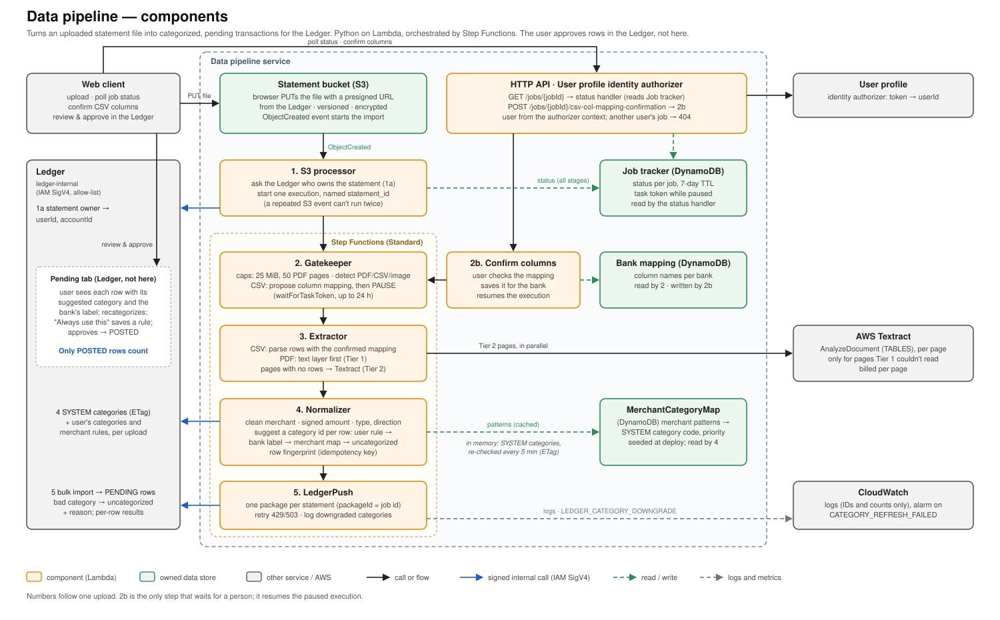

# Data Pipeline Architecture

| Status | Owner | Last reviewed | Applies to | App architecture |
|---|---|---|---|---|
| Existing (dev on AWS; Ledger reached through a tunnel) | Van Vo | 2026-10-20 | main | [FinTracker architecture](../../fintracker-architecture/fintracker-architectural-doc.md) |

This document describes how the Data pipeline works and the workflows it owns. Rules that apply to every service are in the app architecture doc. These include identity, events and invariants. Field-level rules, payloads and schemas live in the specs listed in section 5.

---

## 1. Overview

**Purpose:** the Data pipeline turns an uploaded bank statement (CSV, PDF or image) into clean transactions, each with a suggested category, and hands them to the Ledger as pending. It is a separate service because parsing and categorization are slow, retry-heavy background work. A failed or slow import must never affect the system of record.

**Responsibilities**
- **Start an import** from the storage event, after the Ledger confirms who owns the statement.
- **Check the file:** size and page limits, and format detection.
- **CSV column check:** propose which columns are date, merchant and amount, and wait for the user to confirm.
- **Extract rows:**
  - CSV, with the confirmed mapping;
  - PDF, from the text layer first;
  - Textract only for pages the text layer can't read.
- **Normalize each row:** merchant, signed amount, type and direction, plus an idempotency key.
- **Suggest a category** for each row as a Ledger category id (XS-DPCAT-03).
- **Deliver** one package per statement to the Ledger, and report the job's status to the client.

**Does not do**
- Approve transactions or decide their final category. The user reviews and approves them in the Ledger's Pending tab (XS-DPCAT-04).
- Own categories or merchant rules. The Ledger does. The pipeline keeps a read-only copy of the SYSTEM categories in memory (XS-DPCAT-02).
- Issue upload URLs or keep statement records. The Ledger does today; the Document service will later.
- Detect duplicate statements or months. The Ledger does before the upload starts (LG-STMT-03, LG-STMT-06).

**Owns**
- **Job tracker** (DynamoDB): the import job's status per statement.
- **Bank mapping** (DynamoDB): known column names per bank.
- **MerchantCategoryMap** (DynamoDB): merchant patterns mapped to SYSTEM category codes.
- **The bank-label table** (in code): bank category labels mapped to SYSTEM category codes.
- **Statement bucket** (S3): provisioned here today. It moves to the Document service (app doc D8).

---

## 2. Architecture and workflows

**How to read the diagram**
- The numbers follow one upload. Steps 2–5 run in one Step Functions Standard execution, named after the statement id.
- **2b** is the only step that waits for a person. The Gatekeeper pauses the execution for a CSV, and confirming the columns resumes it.
- Every call to the Ledger is signed with the calling Lambda's IAM role (blue arrows), and the Ledger checks the role against its allow-list. The user travels in the signed user context, never in the request body.
- **Review and approval happen in the Ledger, not here.** The pipeline only suggests a category. The Ledger checks it on import, and only rows the user approves (POSTED) count toward budgets and Analytics.

### Workflows

#### Import a statement

**Trigger:** the file lands in the statement bucket · **Result:** the statement's rows stored in the Ledger as `PENDING`, and the job `COMPLETED` · **On failure:** each stage records `FAILED` with a reason code, then Step Functions ends the execution

1. **S3 processor:**
   - Asks the Ledger who owns the statement. It never trusts user or account IDs from the object's metadata (DP-ING-05).
   - Starts one execution named after the statement id, so a repeated S3 event can't run the import twice.
   - An unknown statement starts nothing.
2. **Gatekeeper:**
   - Rejects files over 25 MiB or PDFs over 50 pages, before any paid call runs (DP-ING-04).
   - Detects the format.
   - For a CSV, it proposes a column mapping and pauses (see the next workflow). A PDF or image goes straight on.
3. **Extractor:**
   - **CSV:** parses rows with the confirmed mapping, including the bank's category column. A row that fails to parse is skipped and logged; it never fails the file.
   - **PDF, Tier 1:** reads the text layer.
   - **Tier 2:** renders each page Tier 1 couldn't read as an image in the bucket, then sends it (or an uploaded image) to Textract, in parallel, with 3 attempts per page.
   - No rows at all ends the job with `NO_VALID_TRANSACTIONS`.
4. **Normalizer:**
   - Cleans the merchant and parses a signed amount.
   - Sets an interim type and direction from the sign (DP-TXT).
   - Computes the row fingerprint.
   - Suggests a category id. The first match wins:
     1. the user's merchant rule;
     2. the bank's label, matched to the user's own categories, then to a SYSTEM code through the bank-label table, then to SYSTEM codes directly;
     3. MerchantCategoryMap patterns;
     4. `uncategorized`.
   - It reads the user's categories and rules from the Ledger once per upload, and SYSTEM categories from its in-memory copy.
5. **LedgerPush:**
   - Sends one package per statement. The package id is the job id.
   - The Ledger stores every row as `PENDING`. A bad category id is stored as `uncategorized` with a reason (XS-DPCAT-05).
   - Retries on 429/503 or a dropped connection (up to 4 attempts).
   - Sets the job to `COMPLETED`, `PARTIALLY_COMPLETED` or `FAILED` from the per-row results.

#### Confirm CSV columns

**Trigger:** a CSV reaches the Gatekeeper · **Result:** the execution resumes with the confirmed mapping · **On failure:** after 24 hours Step Functions ends the paused execution (see open questions)

1. The Gatekeeper matches the CSV's headers against the bank's known column names and the defaults (`date`, `merchant`, `amount`).
2. It stores the proposal and the task token on the job, sets `PENDING_CSV_COL_MAPPING_CONFIRMATION`, and leaves the task unresolved. Every CSV pauses, even when every column matched, so a bank's format change is caught by the user.
3. The client polls `GET /jobs/{jobId}` and shows the dialog with every column, mapped or not.
4. The user confirms or corrects the mapping (`POST /jobs/{jobId}/csv-col-mapping-confirmation`). The handler:
   - checks that the job belongs to the caller;
   - saves the mapping for that bank;
   - resumes the execution.

#### Refresh the category copy *(removed by XS-DPCAT v3 once built)*

**Trigger:** a Normalizer cold start, or the next use 5 minutes after the last check · **Result:** a current read-only copy of the SYSTEM categories · **On failure:** keep the last copy and alarm; with no copy, the job fails with `CATEGORIES_UNAVAILABLE`

1. On a cold start, fetch the SYSTEM categories from the Ledger and keep them in memory with their ETag.
2. After 5 minutes, re-check with `If-None-Match`. A 304 (Not Modified) keeps the copy; a 200 replaces it.
3. A mapped code missing from the copy forces one refresh per upload, before the code counts as no match.
4. Rows the Ledger downgraded are logged as `LEDGER_CATEGORY_DOWNGRADE`. LedgerPush can't refresh the Normalizer's memory, so the copy catches up on its next scheduled check.

---

## 3. Concepts of Operation

### 3.1 Enter: what does this service expose and consume?

| Interface | Type | Caller / producer | Purpose |
|---|---|---|---|
| `GET /jobs/{jobId}` | Public API (HTTP API) | Web client | Job status and a reason code; the job id is the statement id |
| `POST /jobs/{jobId}/csv-col-mapping-confirmation` | Public API (HTTP API) | Web client | Confirm or correct the CSV columns and resume the import |
| `ObjectCreated` on the statement bucket | Storage event consumed | S3 | Starts an import |
| `UploadAccepted(type=statement)` *(proposed)* | Event consumed | Document service | Replaces the storage event (app doc 4.3) |
| Statement owner lookup | Internal call (Ledger) | — | Verified `userId` and `accountId` |
| SYSTEM categories; user's categories and merchant rules | Internal call (Ledger) | — | Category suggestion |
| Bulk import | Internal call (Ledger) | — | One package per statement; per-row results |

Contract files: the handler modules in `src/` and the Ledger's internal controllers; there is no OpenAPI file yet.

### 3.2 Trust: who may call it, and how is each request scoped to a user?

- **Public routes:**
  - The HTTP API runs the User profile identity authorizer.
  - Handlers read the user only from `requestContext.authorizer.lambda.internal_user_id`. A client-sent `X-Internal-User-Id` header is ignored.
  - Another user's job answers 404, on both routes. No identity answers 401.
- **The storage event** carries only the statement id and the bank id. The owner comes from the Ledger, and an unknown statement starts nothing.
- **Calls to the Ledger** are SigV4-signed with each Lambda's own role. Only the S3 processor, Normalizer and LedgerPush roles are allow-listed (`ledger_allowed_caller_arns`).
- **IAM:** one role per Lambda, each with single actions on one table or bucket. The only `Resource: "*"` grants are where AWS offers nothing narrower: Textract, task-token calls, and Step Functions log delivery ([IAM roles](../flows/data-pipeline-iam-roles.md)).

### 3.3 Flow: how does it depend on other services?

| Depends on | How | Why | If unavailable |
|---|---|---|---|
| Ledger: owner lookup | Sync, signed | Verified owner before any work | Nothing starts; the event is logged and dropped |
| Ledger: categories | Sync, signed; SYSTEM cached 5 min with ETag | Suggest valid category ids | Keep the last SYSTEM copy and alarm. With no copy, or no user categories, the job fails with `CATEGORIES_UNAVAILABLE` |
| Ledger: bulk import | Sync, signed, retried | Deliver pending rows | After retries the job is `FAILED`; re-running the statement is safe (3.6) |
| User profile authorizer | Called by API Gateway | Token → internal user id | Public routes answer 401/5xx; imports already running continue |
| Textract | Sync, per page, retried with backoff | Scanned pages and images | A page that keeps failing is skipped; the job fails only if no rows remain |

The pipeline calls the Ledger synchronously, as the app doc allows for the owner check and import. Nothing calls the pipeline except the client and the storage event.

### 3.4 Store: what data does it keep, and for how long?

| Data | Store | Retention | On account deletion |
|---|---|---|---|
| Job status, task token, mapping proposal | DynamoDB Job tracker | 7 days (TTL) | Expires within 7 days; no handler yet |
| Column names per bank | DynamoDB Bank mapping | Until changed | Not per user; nothing to delete |
| Merchant patterns | DynamoDB MerchantCategoryMap | Reloaded from the seed on every deploy | Not per user |
| Statement files *(today)* | S3, versioned, encrypted | Until the statement is deleted | Moves to the Document service's deletion |
| Page images for Textract | S3, next to the statement file (`…/page_N.jpg`) | No expiry rule today (see open questions) | Should go with the statement file |
| SYSTEM categories copy | Lambda memory | Until the container is recycled | Not per user |

Transactions are never stored here. They exist only inside one execution's state and then in the Ledger.

### 3.5 Protect: what does this service guard beyond the app-level rules?

- **Paid calls are capped before they run:** a 25 MiB file limit and a 50-page PDF limit at the Gatekeeper. Textract runs only for pages the text layer can't read.
- **No statement content in logs:** only IDs, counts, tiers and reason codes (DP-ING-08). Request bodies sent to the Ledger are never logged.
- **No shared learning:** one user's categorizations never change another's. Merchant rules are per user and live in the Ledger (DP-CAT-01). The column mapping per bank is shared (see open questions).
- **No paid classifier:** Comprehend is removed. Categories come from rules, bank labels and seeded patterns.
- **The pipeline can't decide a user's final numbers:** it only suggests categories, and every row arrives as `PENDING`.

### 3.6 Recover: how does it fail, and how does it recover?

- **One execution per statement:** the execution name is the statement id, so a repeated S3 event collides instead of importing twice.
- **Delivery is idempotent:** the Ledger skips rows whose `(statement, row fingerprint)` it already has, and reports them as `ALREADY_STORED` ([Ledger SDR-001](../../fintracker-ledger-doc/architecture/decision_records/SDR-001-import-idempotency.md)).
- **Partial failure stays partial:**
  - a bad CSV row or a failed page is skipped;
  - a row the Ledger can't store marks the job `PARTIALLY_COMPLETED`, not `FAILED`.
- **Every stage records `FAILED` with a reason code** before it re-raises. Step Functions then routes the error to a Fail state, so the failure is visible in both the job status and the execution history.
- **Replay:** re-run the statement's execution (or re-upload). Idempotent delivery makes this safe.

### 3.7 Observe: how do we know it is healthy?

- Job outcomes per day: completed, partially completed, failed by reason.
- Alarm on `CATEGORY_REFRESH_FAILED` (CloudWatch metric filter on the Normalizer's logs).
- `LEDGER_CATEGORY_DOWNGRADE` counts per reason: how often the category copy was stale.
- Textract pages per day: the main cost driver.
- Step Functions failed and timed-out executions.

---

## 4. Service decisions

Cross-service decisions this service applies are in the app architecture doc: D3 (internal user id), D6 (messaging, once `UploadAccepted` ships), D7 and D18 (signed internal calls to `ledger-internal`), D8 (file ownership moves to the Document service). The category contract with the Ledger is [XS-DPCAT](../../fintracker-cross-services/specs/XS-DPCAT-dp-ledger-categories-spec.md).

| # | Decision | Choice | Why | Revisit when | Status | Record |
|---|---|---|---|---|---|---|
| S1 | Orchestration | Step Functions Standard, one execution per statement, named after the statement id | Waits up to 24 h for the column check, retries per stage, visible history; the name blocks double runs | Volume makes per-transition cost material (use Express for files that never pause) | Accepted | — |
| S2 | Job id | The Ledger's statement id | The client polls with an id it already has; no correlation table | Never | Accepted | — |
| S3 | Extraction tiers | Text layer first; Textract only for pages without rows | Most bank PDFs are digital, and Textract is billed per page | Text-layer rows are wrong often enough to cost more in user fixes | Accepted | — |
| S4 | Categorization | Rules, bank labels and seeded patterns; no ML, no shared cache | Comprehend's always-on endpoint cost about $1,300/month, and shared learning leaks between users (DP-CAT-01) | The uncategorized rate stays high after users build their rules | Accepted | — |
| S5 | Category data | Read-only SYSTEM copy from the Ledger's API (5 min, ETag), user categories per upload; the Ledger has the final say | No category data owned here, no database access to the Ledger, and a stale copy costs only a suggestion (XS-DPCAT-02, -05) | — | Superseded by XS-DPCAT v3 (codes only; not yet built) | — |
| S6 | Delivery | One bulk package per statement, fingerprint per row | One call per statement, safe retries, per-row results | Bank sync arrives (use the bank's transaction id) | Accepted | — |
| S7 | Column check | Every CSV pauses for confirmation; confirmed mappings are saved per bank | A bank's format change is caught by the user instead of producing wrong data | Users find the pause annoying for banks whose mapping never changes | Accepted; mapping storage extended by DP-MAP | — |

**Decided changes, not yet built** (this doc changes with the code that implements them)
- **Category codes only (S5 → superseded):** the pipeline will suggest SYSTEM codes and hold no copy of categories. The Ledger will turn codes into categories and apply the user's rules and own categories on import. The "Refresh the category copy" workflow and its alarm go away ([XS-DPCAT](../../fintracker-cross-services/specs/XS-DPCAT-dp-ledger-categories-spec.md) v3).
- **Column check expires after 30 minutes, and can be cancelled.** Every failure goes through one RecordFailure step ([DP-ING-09](../specs/DP-ING-statement-ingestion-spec.md)).
- **Failed imports reach the Ledger,** and uploading the same file again starts clean ([XS-IMP-02, -03](../../fintracker-cross-services/specs/XS-IMP-statement-import-contract-spec.md)).
- **Low-confidence rows are flagged** in the package and highlighted in the Pending tab (XS-IMP-01).
- **Only reason codes reach the user;** the UI turns each into a message and a next step (XS-IMP-04, DP-ING-10).
- **Rendered Textract pages are never stored, failed ones included.** A failed page is logged with the statement id and page number, and rendered again from the original file when debugging (DP-ING-11).
- **Column mappings per bank and header signature (S7 → extended):**
  - the user's own mapping is proposed first;
  - format changes are alarmed;
  - agreed mappings are promoted to the baseline ([DP-MAP](../specs/DP-MAP-csv-column-mapping-spec.md)).

**Open questions**
- **`ledger-internal` isn't provisioned yet** (ADR-011). Until it is, nothing in AWS checks the pipeline's signatures, and dev reaches a local Ledger through a tunnel.
- **Transaction type is interim:** it comes from the amount's sign, so refunds and transfers aren't recognized yet (DP-TXT P-01 to P-09).

---

## 5. Related documents

- **App architecture:** [FinTracker architecture](../../fintracker-architecture/fintracker-architectural-doc.md).
- **Decisions:** [ADR-004](../../fintracker-architecture/architectural_decision_records/ADR-004-internal-api-regional-iam.md), [ADR-011](../../fintracker-architecture/architectural_decision_records/ADR-011-internal-api-per-service.md); Ledger [SDR-001](../../fintracker-ledger-doc/architecture/decision_records/SDR-001-import-idempotency.md) (import idempotency).
- **Specs:**
  - [DP-ING-statement-ingestion-spec.md](../specs/DP-ING-statement-ingestion-spec.md) (import, tiers, limits, tenant checks). Its "Not Implemented" markers predate most of the code: tiers, limits, the column check, owner lookup and the bulk push are built.
  - [DP-CAT-categorization-spec.md](../specs/DP-CAT-categorization-spec.md) (Comprehend removal, merchant rules). Its interface section is superseded by XS-DPCAT.
  - [DP-TXT-transaction-type-category-spec.md](../specs/DP-TXT-transaction-type-category-spec.md) (open problems with types).
  - [XS-DPCAT-dp-ledger-categories-spec.md](../../fintracker-cross-services/specs/XS-DPCAT-dp-ledger-categories-spec.md) (categories contract with the Ledger).
  - [XS-IMP-statement-import-contract-spec.md](../../fintracker-cross-services/specs/XS-IMP-statement-import-contract-spec.md) (review flag, failed imports, re-upload, reason codes; not yet built);
  - [DP-MAP-csv-column-mapping-spec.md](../specs/DP-MAP-csv-column-mapping-spec.md) (column mappings per format, format-change detection, promotion; not yet built).
- **Flows:**
  - [data-pipeline-target-flow.md](../flows/data-pipeline-target-flow.md) (category flow, high level);
  - [2026-09-16-processing-csv-bank-statement.md](../flows/2026-09-16-processing-csv-bank-statement.md) (historical: still shows Comprehend and one call per transaction);
  - [data-pipeline-iam-roles.md](../flows/data-pipeline-iam-roles.md) (IAM per Lambda; predates the removal of Comprehend and MerchantRegistry).
- **Runbook:** [deploy_dp_ledger_categories.md](../../instructions/deploy_dp_ledger_categories.md); infrastructure: `services/fintracker-data-pipeline/infrastructure/terraform/README.md`.
- **Diagram:** `images/data-pipeline-components.svg`.
