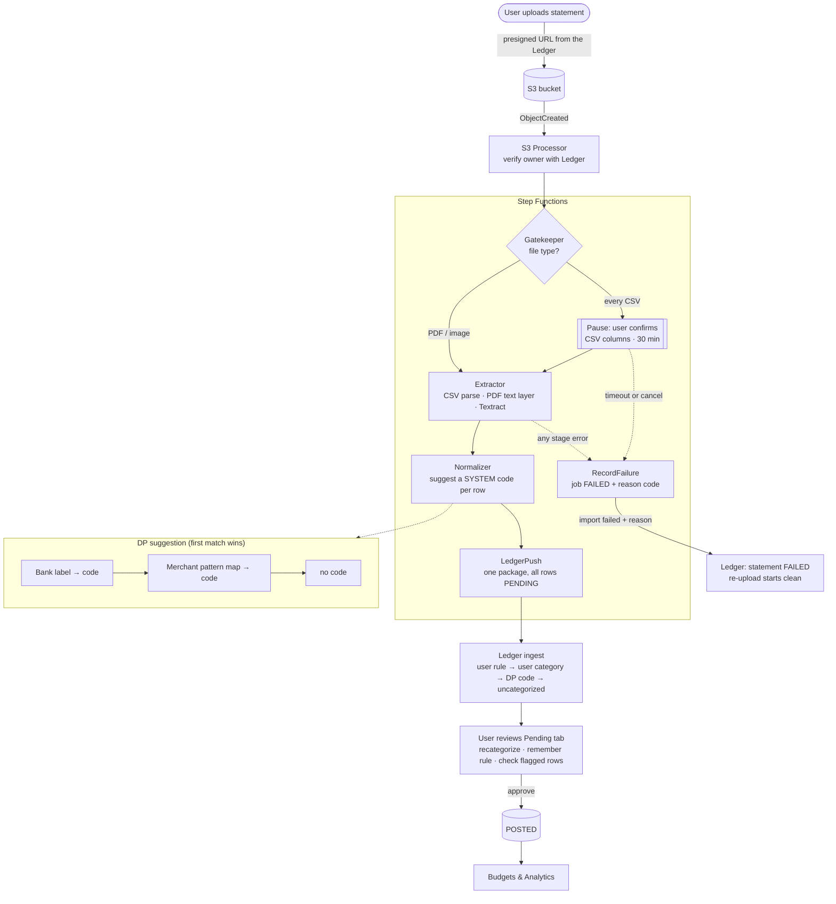

# Data Pipeline: Target Flow (after XS-DPCAT v3, XS-IMP, DP-ING-09 to -11 and DP-MAP)

High-level logic only. For what runs today, see the [Data pipeline architecture](../architecture/data-pipeline-architecture.md). This file shows the flow once the specs above are implemented. Updated 2026-10-21: the pipeline sends category codes, the Ledger applies the user's categories and rules, and failed imports reach the Ledger.

## Chart description

1. **Upload.** The browser uploads the file straight to S3. The S3 event starts the pipeline after the Ledger confirms who owns the statement.
2. **Gatekeeper.**
   - It checks the file's size and page count, and detects its type.
   - Every CSV pauses until the user confirms which columns are date, merchant and amount (DP-ING-01, DP-MAP).
   - The pause ends after 30 minutes, or at once if the user cancels (DP-ING-09).
3. **Extractor.**
   - A CSV is read directly, including the bank's category column.
   - A PDF is read from its text layer first.
   - Pages without text go to Textract as bytes. Rendered pages aren't stored (DP-ING-11).
4. **Normalizer.** It suggests a SYSTEM category **code** for each row: first from the bank's label (bank-label table), then from the merchant pattern map, otherwise no code (XS-DPCAT-03). It holds no copy of the Ledger's categories and never sends a category id.
5. **LedgerPush.** It sends one package per statement. Every row is marked PENDING and carries its code, the bank's label, the merchant key and a review flag for low-confidence rows (XS-IMP-01).
6. **Ledger.**
   - It skips rows it already has.
   - It chooses each row's category: the user's merchant rule, then the user's own category matching the bank label, then the pipeline's code, then `uncategorized` (XS-DPCAT-07).
   - Everything stays PENDING.
7. **Review.** In the Pending tab the user checks flagged rows, fixes categories (optionally saving a "remember this merchant" rule) and approves. Only approved rows count toward budgets and analytics.
8. **Failure.**
   - Any failure, timeout or cancel goes through one RecordFailure step. It stores a reason code on the job and tells the Ledger (XS-IMP-02).
   - The statement shows as failed with a next step for the user, and uploading the file again starts clean (XS-IMP-03, XS-IMP-04).
