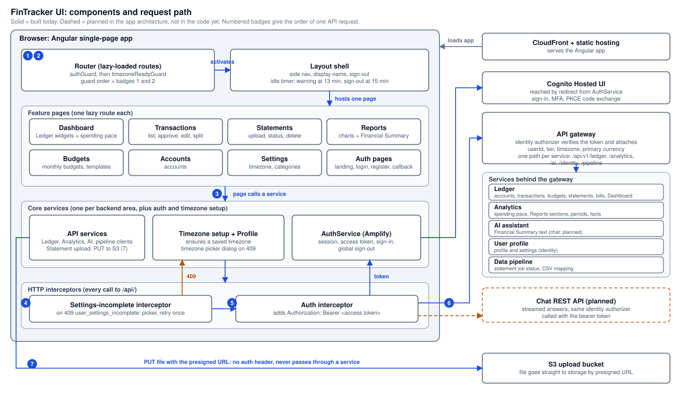

# UI Architecture

| Status | Owner | Last reviewed | Applies to | App architecture |
|---|---|---|---|---|
| Existing. Items marked *(planned)* follow the app architecture and are not in the code yet | Van Vo | 2026-10-23 | main | [FinTracker architecture](../../fintracker-architecture/fintracker-architectural-doc.md) |

This document describes the FinTracker web client (`fintracker-ui`): its components, the workflows it runs, and how it applies the app-level rules for identity, timezone and failure handling. Rules that apply to every service are in the app architecture doc and are not repeated here.

Where the code and the app architecture disagree, **the app architecture is the target** and this document describes that target. The code is behind in these places, each marked *(planned)* below:

- Dashboard figures are computed in the browser instead of served by the Ledger (D21).
- Statement upload and download still use the Ledger and S3 directly (Document service is proposed).
- Chat has no UI yet (D19).
- The Ledger's local-development auth shortcut is still in the client (invariant 2).
- Tokens are in Amplify's default storage, not `sessionStorage` (S9).

Each planned change has a requirement in [fintracker-ui-doc/specs](../specs/) (see section 5).

---

## 1. Overview

**Purpose:** The UI is the only thing the user sees. It signs the user in, shows what the other services return, and sends the user's actions to them. It is a separate deployable (a static Angular app on CloudFront) so that every business rule stays in the services and the browser stays replaceable.

**Responsibilities**
- Sign-in and session handling through the Cognito Hosted UI, including idle sign-out.
- Make sure the user has a timezone before the signed-in app loads (XS-CTX-01).
- The seven tabs: Dashboard, Transactions, Statements, Budgets, Reports, Accounts, Settings.
- Show each service's answers with its own loading, empty and error states, so one failing service never blanks a page.
- Statement upload from the browser: content hash, direct-to-storage upload, status polling and the user decisions the import needs (CSV column mapping, duplicates).
- Chat panel with streamed answers *(planned)*.

**Does not do**
- Compute any figure the user sees as income, spending, balance, pace or trend. The Ledger and Analytics do (D21, D22).
- Call an LLM or write summary text. The AI assistant does; the UI only displays it.
- Decide who the user is or which rows they may see. The identity authorizer and the services do (invariants 2–5).
- Store or scan files. S3 holds them today and the Document service will *(proposed)*.
- Parse statements. The Data pipeline does; the UI only polls its job status.
- Look up user settings per request. Timezone and currency arrive in the verified context (D23).

**Owns**
- No persistent data. The browser holds the Amplify session (tokens) and in-memory page state, and nothing else.

---

## 2. Architecture and workflows

**How to read the diagram**
- Everything signed-in runs inside one **Layout shell**, reached through two route guards: sign-in first (1), then timezone (2).
- A page never calls a backend directly. It calls one **API service** per backend area (3), and every call to `/api/` passes through two interceptors: the timezone-prompt interceptor (4) and the auth interceptor (5), which adds the bearer token. The gateway's identity authorizer (6) does the rest (app doc 4.2).
- Two calls skip the interceptors by design: sign-in goes to Cognito's Hosted UI, and the statement file goes straight to S3 by presigned URL (7). It carries no token, and files never pass through a service (invariant 6).
- Services answer each page's requests independently. That is what lets a Dashboard card or a Reports section fail alone.
- The interceptor order matters. The timezone-prompt interceptor wraps the auth interceptor, so when a service answers 409 `user_settings_incomplete`, the picker opens and the request is retried once with a fresh token.

### Workflows

#### Sign in and enter the app

**Trigger:** the user opens a signed-in route or clicks Sign in · **Result:** a Cognito session and a saved timezone · **On failure:** back to the login page with an error

1. `authGuard` checks the Amplify session. No session sends the user to the login page.
2. The login and register pages are one button each. Both start the Cognito Hosted UI redirect with PKCE. The SPA never sees a password.
3. Cognito signs the user in (MFA included) and redirects to the callback page with an authorization code.
4. Amplify exchanges the code during app start-up. The callback page listens for the sign-in event and also checks for an existing session, because the exchange can finish before the page mounts. It falls back to the login page after 10 seconds.
5. `timezoneReadyGuard` loads the profile. If no timezone is saved, it saves the browser's IANA timezone. If the browser reports none, or the server refuses it, a picker opens with nothing preselected and cannot be dismissed. A profile that cannot be loaded never blocks the app.
6. The Layout shell starts the idle timer and loads the display name, falling back to "Account".

#### Call an API *(the numbered path in the diagram)*

**Trigger:** any page action · **Result:** the service's answer · **On failure:** the page shows its own error state

1. `authGuard`: the route is allowed only with a session.
2. `timezoneReadyGuard`: the signed-in app loads only once a timezone exists.
3. The page calls its API service. The request carries no user ID, timezone or currency.
4. Timezone-prompt interceptor: a 409 `user_settings_incomplete` response opens the picker, saves the choice, and retries the request once.
5. Auth interceptor: attaches `Authorization: Bearer <access token>`. Amplify refreshes the token silently. If the refresh fails, the user is signed out.
6. The gateway's identity authorizer verifies the token and attaches the user context. The service answers.

#### Open the Dashboard *(planned: the code still computes the figures)*

**Trigger:** the Dashboard tab loads · **Result:** this month's picture · **On failure:** the failing card shows its own error and a retry; the others still render

1. In parallel, request the Ledger widgets: data-through date and pending count, summary cards, budget alerts, this month's bills, recent transactions. The Ledger resolves "this month" from the user's timezone (D21, D23).
2. Request the spending-pace card from Analytics separately, so an Analytics outage affects only that card.
3. Render what came back. The page has no period selector, no charts and no client-side totals, and the pending count tells the user how many rows aren't in the totals yet.

*Code today:* one Ledger call for totals, then the whole transaction list, from which the browser builds a pie, a trend and a cash-flow chart for a selectable range, using the browser's clock. Those charts belong to Reports (D21), and the browser's clock can disagree with the user's saved timezone.

#### Open Reports

**Trigger:** the Reports tab loads or the period changes · **Result:** charts, tables and the Financial Summary for the period · **On failure:** per section, as below

1. In parallel, load the periods (Last month, Last 3 months, Year to date, Last 12 months; no *This month*) and the report for the default period.
2. One selector drives the Financial Summary, spending by category and top merchants. The two trend charts always show the last 12 complete months. One `/reports` request returns all four chart sections.
3. A section that failed on the server arrives as `null` with a reason and shows its own error. If the whole request fails, the previous charts stay and a Retry button appears.
4. The Financial Summary panel loads on its own. It requests the facts and the AI summary in parallel, and the numbers render first.
5. The summary text holds placeholders; the UI fills every figure from the facts payload, so the model never supplies a number. The panel always shows "Informational only. Not financial advice."
6. If the AI assistant returns a facts-only fallback, the panel shows the facts and the reason. Refresh uses the remaining count the server returns. The UI does not hardcode a limit *(planned, UI-RPT-01: today it assumes 5 a day; the AI assistant allows 10)*.
7. An answer for a period that is no longer selected is dropped.

#### Upload a bank statement

**Trigger:** the user submits the upload form · **Result:** a statement in Processing, then Completed with pending rows · **On failure:** an error panel with the reason

1. The user picks an account and a file. For a CSV the UI also asks for the bank and pre-fills the statement dates from the file's date column; the user can correct them.
2. The browser computes the SHA-256 of the file. The server recomputes it and trusts its own value.
3. `POST` to the Ledger creates the statement record. The Ledger checks account ownership and duplicates and returns a presigned URL. A duplicate answer opens one dialog (overwrite or cancel); overwrite resubmits with the old statement's ID.
4. The browser `PUT`s the file straight to S3 (diagram step 7).
5. The UI polls the Data pipeline job every 3 seconds, up to 1,000 polls. It stops on a final status or when the import needs a decision.
6. Two decisions can pause the import: confirming the CSV column mapping, and resolving a duplicate found after the file was read. Each opens a dialog. An overwrite restarts the upload.
7. On Completed or Partially completed, the Statements list refreshes. Imported rows arrive *pending*; the user approves them in Transactions before they count (app doc 5).

*With the Document service (planned):* step 3 creates the statement record in the Ledger, then the UI asks the Document service for an upload URL and uploads to quarantine. The Data pipeline starts from the scanned file's event, and steps 5–7 are unchanged.

#### Delete or download a statement

**Trigger:** a Statements row action · **Result:** the statement removed, or the file downloaded · **On failure:** a snackbar with the reason

1. **Delete:** the UI asks the Ledger, which removes the transactions and the record in one transaction and publishes `StatementDeleted`. The row disappears when the call succeeds (D9).
2. **Download** *(planned)*: the UI asks the Document service for a link, which checks ownership and returns a short-lived URL to the clean bucket. The browser downloads from S3 directly.

#### Ask the chat *(planned)*

**Trigger:** the user sends a message · **Result:** a streamed answer with sources · **On failure:** an error state that keeps the conversation

1. The UI sends the message with `fetch` and the bearer token to the chat REST API, which runs the same identity authorizer (D19). It does not go through the gateway.
2. The UI reads the response as it streams and renders it as it arrives.
3. Sources are shown with the answer. Transaction source pointers (page and row) link to the Statements tab.

#### End a session

**Trigger:** the user signs out, or is idle · **Result:** no session in this browser, and the refresh token revoked everywhere · **On failure:** the UI still leaves the signed-in area

1. After 13 minutes without activity, a dialog starts a 2-minute countdown.
2. "Stay signed in" resets the timer. Reaching zero, or choosing Sign out, runs a global sign-out.
3. The global sign-out revokes the refresh token at Cognito, so every device loses its session. The UI goes to the login page even if the revoke call fails.

---

## 3. Concepts of Operation

### 3.1 Enter: what does this service expose and consume?

The UI is a static app. It exposes routes to the user and consumes the backends below, all through the gateway except where noted.

| Interface | Type | Caller / producer | Purpose |
|---|---|---|---|
| `/`, `/auth/login`, `/auth/register`, `/auth/callback` | Public routes | User | Landing and sign-in. Register is invite-only in dev (app doc 6.1) |
| `/dashboard`, `/transactions`, `/statements`, `/accounts`, `/budgets`, `/reports`, `/settings` | Signed-in routes (both guards) | User | The seven tabs |
| Cognito Hosted UI | External | Cognito | Sign-in, MFA, code exchange |
| `/api/v1/identity/profile`, `PUT …/settings` | Public API | User profile | Name, email, timezone. Only the timezone is saved today; other Settings fields are not wired up |
| `/api/v1/ledger/*`: accounts, categories, transactions (approve, exclude, split, tags, bulk), statements (`initiate-upload`), budgets and templates, bills (pay), `dashboard/*` | Public API | Ledger | Transactions, Statements, Budgets and Accounts tabs, categories in Settings, and the Dashboard widgets |
| `/api/v1/analytics/dashboard/spending-pace`, `reports?period`, `summary/periods`, `summary/facts` | Public API | Analytics | Spending pace; Reports charts; period selector; Financial Summary numbers |
| `/api/v1/ai/summary`, `summary/refresh` | Public API | AI assistant | Financial Summary text |
| `/api/v1/pipeline/jobs/{id}`, `…/csv-col-mapping-confirmation` | Public API | Data pipeline | Import status and the column-mapping decision |
| Presigned S3 `PUT` | Storage URL | S3 | Statement upload, no token |
| Chat REST API *(planned)* | Public streaming API | AI assistant | Chat |
| Document service upload and download links *(planned)* | Public API | Document service | Statement upload and download |

Stubs today: *Approve all pending* on the Statements tab changes the screen only, and Reports CSV and PDF export shows a "not wired up" message. Neither has a backend call.

Contract files: the backends' contracts are in each service's architecture doc (section 3.1). The Ledger's route list is `fintracker-ledger-doc/ledger-api-endpoints`.

### 3.2 Trust: who may call it, and how is each request scoped to a user?

- **Identity:** the user signs in with Cognito (PKCE; the app client is public and holds no secret). Every `/api/` call carries the access token. The UI never sends a user ID, timezone or currency, and never reads claims from the token to decide what a user may see. Route guards are for navigation only. Authorization happens in the services (invariants 2 and 5).
- **Local-development exception:** the Ledger runs locally with no gateway. In non-production builds only, and only for `/api/v1/ledger` calls, the auth interceptor sends `X-Internal-User-Id` (from a dev user map) plus the timezone and currency headers from the saved profile. Every other backend always gets the bearer token. A production build never sends these headers, and the gateway overwrites them if one did. *(Planned, UI-AUTH-02: delete this path when the Ledger sits behind the gateway, because invariant 2 allows no bypass.)* The dev Cognito IDs and the dev user map are committed in `environment.ts`; the production file replaces it at build time.
- **Session storage:** tokens belong in `sessionStorage`, so they last only as long as the tab (S9). *(Planned, UI-AUTH-01: the code does not configure it, so Amplify's default `localStorage` is in use today.)*
- **Idle limit:** 15 minutes, enforced in the browser (S8). It is a convenience on shared computers, not a security boundary, because the token itself still expires on Cognito's schedule.
- **Subscription tier:** attached by the authorizer but enforced nowhere (app doc 4.2). The UI does not gate features by tier yet.

### 3.3 Flow: how does it depend on other services?

| Depends on | How | Why | If unavailable |
|---|---|---|---|
| Gateway and identity authorizer | Sync HTTPS | Every API call | Calls fail; a failed token refresh signs the user out |
| Cognito Hosted UI | Browser redirect | Sign-in | Users cannot sign in; existing sessions keep working until the token expires |
| Ledger | Sync, one call per widget | Money records and Dashboard widgets | Each widget shows its own error and retry; no widget blocks another |
| Analytics | Sync | Spending pace and Reports | Only the spending-pace card, or the affected Reports section, shows an error. A failed `/reports` keeps the previous charts and offers Retry |
| AI assistant | Sync; chat streams *(planned)* | Summary text | The panel keeps the previous summary or shows facts only; numbers come from Analytics and render first |
| User profile | Sync | Timezone and display name | A profile that won't load never blocks the app; the display name falls back to "Account" |
| Data pipeline | Polling every 3 s | Import status | "Lost connection" message; the import may still finish, so the user checks the Statements list |
| S3 | Direct `PUT` | Statement file | The upload fails; the Ledger's record stays Processing |
| Document service *(planned)* | Sync | Upload and download links | Upload or download is unavailable; other tabs are unaffected |

### 3.4 Store: what data does it keep, and for how long?

| Data | Store | Retention | On account deletion |
|---|---|---|---|
| Cognito tokens (Amplify session) | Browser `sessionStorage` *(planned; `localStorage` today)* | Until sign-out or token expiry; sign-out revokes the refresh token | Nothing to delete: User profile disables the account and the session ends |
| Page state, loaded lists, the settings cache (local dev only) | Browser memory | Until the page reloads | Gone with the page |

The UI keeps no financial data in browser storage. The reviewed code stores nothing in the browser itself.

### 3.5 Protect: what does this service guard beyond the app-level rules?

- **Server-side checks are the real ones.** File type and size checks in the upload form and the browser's content hash only save the user time. The malware scan, ownership checks and duplicate checks happen on the server (invariant 6).
- **No number is invented in the browser.** Dashboard and Reports figures are rendered as received (strings with 2 decimals; the UI doesn't round or re-add them), and the Financial Summary's figures come from the facts payload, never from model text. The Ledger stores amounts positive with a direction, and the UI shows the sign.
- **Dates are never converted.** A date like `2026-09-01` stays a calendar date (D24). Parsing it as a UTC timestamp moved first-of-month rows into the previous month in an earlier bug. The timezone is used only by the server to decide "today".
- **Error text:** the UI shows a service's `detail` message when it sends one and a generic message otherwise. Logs written by the UI must not include financial values, descriptions or form contents. *(Planned, UI-CORE-02: the Settings profile stub logs the form values to the console today.)*
- **AI output labeling:** every summary shows "Informational only. Not financial advice."
- **Browser hardening *(planned, Phase 2)*:** no Content Security Policy yet, and no CORS restriction on the backends. A script injected into the page could read the stored tokens, so this is the main open risk of the client.

### 3.6 Recover: how does it fail, and how does it recover?

- **Fail by part:** each card, section and panel has its own loading, empty and error state, and an empty ledger is shown as empty, never as demo data.
- **Keep what the user already has:** a failed reload leaves the previous charts or summary on screen with a retry.
- **Stale answers are dropped:** a response for a period or request that is no longer current never overwrites the page.
- **Timezone gaps:** a 409 `user_settings_incomplete` opens the picker, saves the choice, and retries the request once. If the user never chooses, the request is not retried.
- **Imports:** polling stops on a final status or a status that waits for the user. A new waiting status added in the pipeline must also be added to the UI's waiting list, or the UI will keep polling and the user is never asked. A re-upload of the same file is caught by the duplicate dialog.
- **Cold start in dev:** Aurora can take 15–30 seconds to resume (app doc 4.6), and the app doc requires clients to time out above that and retry. *(Planned, UI-CORE-01: the UI sets no request timeout or retry today.)*
- **Session loss:** a failed token refresh signs the user out and returns them to the login page.
- **Zoneless rendering:** the app runs without zone.js, so data that arrives after a render must be held in signals (or announced with `markForCheck`). Plain fields updated from a subscription stay invisible until something else triggers a render. This caused the Dashboard bug where data appeared only after the window was resized.

### 3.7 Observe: how do we know it is healthy?

- **Not defined at app level.** The app doc's observability section covers services only. The UI sends no trace header; the first service a request reaches starts the trace.
- **The numbers users feel** are server-side. The Dashboard's critical path is the Ledger's summary (target under 200 ms), the spending-pace card has a 500 ms p95 target, and `/reports` has a 1 s p95 target. Watch them on the services' dashboards.
- **Gap:** there is no client error reporting or real-user monitoring. Failed API calls, a stuck import poll and sign-in failures are visible only in the user's browser console. Decide on a minimal, redacted reporting path before invited testers arrive (UI-CORE-03).

---

## 4. Service decisions

Cross-service decisions the UI applies are in the app architecture doc: D19 (chat entry), D21 (Dashboard and Reports ownership), D22 (reporting views), D23 (settings in the verified context) and D24 (calendar dates); and invariants 2 (identity), 5 (404 across tenants) and 6 (files never pass through a service).

| # | Decision | Choice | Why | Revisit when | Status |
|---|---|---|---|---|---|
| S1 | Framework | Angular 21, standalone components, lazy route per feature, zoneless, Signals for new state, Angular Material, Chart.js through ng2-charts | Small first load, explicit reactive state, no zone.js tax | The Dashboard, Reports and Statements pages move off plain fields and `markForCheck` (a cleanup, not a risk) | Accepted |
| S2 | Sign-in | Cognito Hosted UI with PKCE through Amplify; no credential form in the app | A SPA can't keep a secret; password policy and MFA stay in Cognito | Custom sign-in screens are needed | Accepted |
| S3 | The server owns every figure | The UI renders what the Ledger and Analytics return, with no client-side totals or charts from raw transactions | One definition of income and spending everywhere (D21, D22); no timezone drift | Never | Accepted; Dashboard code *(planned)*, UI-DASH-01 to -03 |
| S4 | One request per widget | Each Dashboard widget, the spending-pace card, each Reports section and the Financial Summary load and fail separately | A slow or failing service never blanks a page (app doc 4.6) | A page needs several widgets to be consistent at one instant | Accepted |
| S5 | Timezone before anything else | A guard saves the browser's timezone for a new user (picker as fallback); a 409 from any service opens the picker and retries once | Services fail closed with no timezone (XS-CTX-01, -05) | Timezone is captured at sign-up | Accepted |
| S6 | Dates and amounts as received | Date-only strings are never parsed as UTC; amounts from Analytics are 2-decimal strings that the UI doesn't recompute | Prevents shifted months and rounding drift (D24) | Bank sync delivers timestamps that need time-of-day logic | Accepted |
| S7 | Interceptor split | Bearer token on every `/api/` call. In local dev only, the Ledger also gets `X-Internal-User-Id` and the settings headers | Lets the Ledger run locally with no gateway | The Ledger is deployed behind the gateway; delete the dev path | Accepted for local dev only; removal *(planned)*, UI-AUTH-02 |
| S8 | Idle sign-out | 13-minute warning with a 2-minute countdown, then global sign-out, enforced in the browser | Protects shared computers; revokes the refresh token everywhere | Cognito session policy changes | Accepted |
| S9 | Token storage | Tab-scoped `sessionStorage` | It is cleared when the tab closes and is not shared across tabs, so a stolen token outlives the tab less often. The cost is signing in again in each new tab (Cognito's own session often makes that instant). It does not stop XSS; the CSP in Phase 2 does | Phase 2 security hardening | Accepted; configuration *(planned)*, UI-AUTH-01 |
| S10 | Chat transport | Plain `fetch` with a bearer token to the chat REST API, reading the stream | Same identity authorizer as everything else (D19) | The streaming spike in ADR-012 fails | Proposed |

---

## 5. Related documents

- **App architecture:** [FinTracker architecture](../../fintracker-architecture/fintracker-architectural-doc.md).
- **App decisions applied here:** [ADR-012](../../fintracker-architecture/architectural_decision_records/ADR-012-chat-streaming-entry-rest-api.md) (chat entry), [ADR-013](../../fintracker-architecture/architectural_decision_records/ADR-013-dashboard-reports-ownership.md) (Dashboard and Reports), [ADR-015](../../fintracker-architecture/architectural_decision_records/ADR-015-settings-in-verified-context.md) (settings in the verified context).
- **Backends the UI calls:** [Ledger](../../fintracker-ledger-doc/architecture/ledger-architecture.md), [Analytics](../../fintracker-analytics/architecture/analytics-architecture.md), [AI assistant](../../fintracker-ai-assistant/architecture/ai-assistant-architecture.md), [Data pipeline](../../fintracker-data-pipelines/architecture/data-pipeline-architecture.md). User profile has no architecture doc yet; see [UP-AUTH](../../fintracker-user-profile-doc/specs/UP-AUTH-authentication-spec.md).
- **Contracts:** each service's section 3.1; Ledger routes in `fintracker-ledger-doc/ledger-api-endpoints`.
- **Change specs:**
  - UI specs, all Proposed: [UI-AUTH](../specs/UI-AUTH-session-security-spec.md) (`sessionStorage`, remove the dev bypass), [UI-DASH](../specs/UI-DASH-dashboard-spec.md) (Dashboard per D21), [UI-STMT](../specs/UI-STMT-statement-actions-spec.md) (upload headers, Document service, approve all), [UI-RPT](../specs/UI-RPT-reports-spec.md) (refresh limit), [UI-CORE](../specs/UI-CORE-client-resilience-spec.md) (timeouts, console hygiene, error reporting, Settings).
  - [XS-CTX: Settings in the verified user context](../../fintracker-cross-services/specs/XS-CTX-verified-user-context-spec.md): the UI's timezone capture (01), 409 handling (05) and settings changes (06) are Implemented.
  - [AN-RPT: Dashboard and Reports widgets](../../fintracker-analytics/specs/AN-RPT-dashboard-reports-widgets-spec.md): the period selector and the spending-pace card are Implemented.
  - [AN-FS: Financial Summary](../../fintracker-analytics/specs/AN-FS-financial-summary-spec.md) and the [AI chat spec](../../fintracker-ai-assistant/specs/AI-CHAT-open-chat-spec.md): the summary panel is built; the chat UI is Proposed.
  - [LG-STMT: Statement upload](../../fintracker-ledger-doc/specs/LG-STMT-statement-upload-spec.md) and [DS-DL: Document download](../../fintracker-document/specs/DS-DL-document-download-spec.md) (Proposed).
  - [Phase 1: Cognito auth](../phases/phase-1-cognito-auth-implementation.md) (Implemented, except the `sessionStorage` setting; see UI-AUTH-01) and [Phase 2: security hardening](../phases/phase-2-security-hardening.md) (Planned: CSP, CORS, auth audit events, MFA enrolment screen).
- **Runbook:** none yet.
- **Diagram source:** `images/ui-components.svg`.
